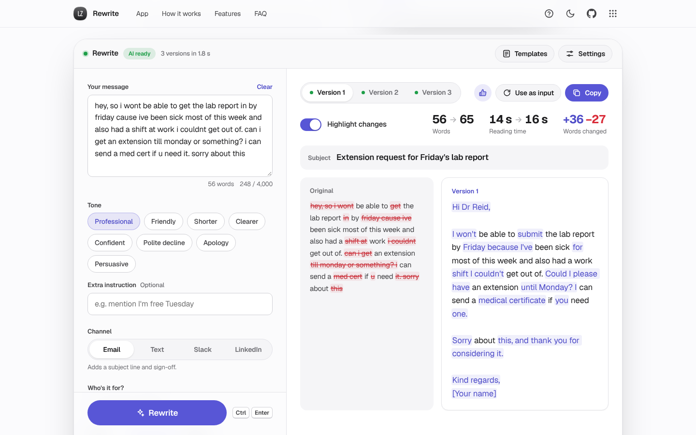

# Rewrite

Say it right the first time. Paste a rough draft, pick a tone and where it's going, and get up to three polished versions with every changed word highlighted.

[](https://lz-rewrite.pages.dev/)

Mirror: https://lazarzec18.github.io/rewrite-ai/



## Features

**Rewriting**
- Eight tone presets: Professional, Friendly, Shorter, Clearer, Confident, Polite decline, Apology and Persuasive, plus your own extra instruction.
- Say who it's for ("my manager", "a customer") so the formality fits.
- Channel aware: Email adds a subject line and sign-off, Text stays short, Slack stays scannable, LinkedIn stays warm and brief.
- A length slider from much shorter to much longer.
- One to three versions in tabs: one close to yours, one restructured, one as tight as possible.
- Streams in as it's written, with a typing caret and a Stop button that keeps what's already there.
- Ctrl or ⌘ with Enter to rewrite from anywhere in the app.

**Checking the result**
- Word-level diff: removed words struck through in the original, added words highlighted in the rewrite. Toggle it off for the clean version.
- Word count, reading time and changed-word counts, before and after, for every version.

**Keeping and reusing**
- Copy (subject and body together), Use as input to refine a version further, and thumbs-up to save it to Favourites.
- History of your last 20 rewrites with search. Open any of them to restore the message, settings and versions.
- Eight templates for messages people find hard to write: asking for an extension, chasing an unpaid invoice, declining a meeting, complaining to a landlord, apologising to a customer, reaching out on LinkedIn, cancelling plans and asking for a pay review.
- Everything (history, favourites, settings, your draft and the last result) is saved in this browser and survives a reload.

**Always works**
- Hosted AI by default, with a status pill in the app bar: AI ready, Using your key, or Demo mode.
- Falls back to your own Anthropic API key (Settings, with Forget key), and otherwise to a demo mode that plays pre-written rewrites of the templates with simulated streaming.
- Clear, specific messages for a rejected key, rate limits, an unreachable server and a busy model, each with the next step.
- A six-step guided tour on first visit, replayable from the ? button.

## How it works

The page talks to a Cloudflare Pages Function at `/api/rewrite`. On load it sends a tiny `GET` to learn whether the server has a key configured. To rewrite, it `POST`s the draft and settings as JSON. The function validates them (text up to 4,000 characters, known tone and channel, 1 to 3 versions), checks the request's `Origin` against an allowlist, applies a per-IP rate limit (10 a minute in memory, plus 60 a day in Workers KV when bound), builds the system prompt on the server and calls the Anthropic Messages API with `stream: true`. The upstream server-sent events body is returned straight through, so the first words reach the browser as soon as Claude writes them and the key never leaves Cloudflare.

All versions come back in one stream, each wrapped in `<version>` tags. The client parses the growing text on every chunk, hiding half-received tags so they never flash on screen, and splits off the email subject line. The same prompt builder (`prompt.js`) is shared by the server and by own-key mode, which calls Anthropic directly from the browser. Demo mode feeds a pre-written tagged string through the exact same parser at typing speed.

When a version finishes, both texts are tokenised into words and compared with a longest-common-subsequence diff: a dynamic-programming table, with the shared start and end trimmed first to keep it small. Runs of changed words are grouped so a replaced phrase reads as one highlight, not many.

## Hosting the AI

1. Deploy this folder to the Cloudflare Pages project **lz-rewrite**. The `functions/` folder is picked up automatically.
2. In the Cloudflare dashboard, open the project and go to **Settings → Variables and Secrets**. Add `ANTHROPIC_API_KEY` as a **Secret** for Production (and Preview if you want previews to work).
3. Optional: set `ANTHROPIC_MODEL` to override the default model, `claude-haiku-5-5`.
4. Optional: create a KV namespace and bind it to the project as `RATE_KV` (**Settings → Bindings → KV namespace**). This adds a limit of 60 rewrites a day per IP on top of the 10 a minute.
5. Redeploy. The app bar should show **AI ready**.

Without the secret, `/api/rewrite` answers `503 {"error":"not_configured"}` and the app falls back to the visitor's own key or demo mode. The GitHub Pages mirror calls the Cloudflare function cross-origin (it's on the CORS allowlist), and falls back the same way if it can't reach it.

## Tech

- HTML, CSS and JavaScript ES modules. No framework, no build step.
- Zec Labs design kit (`zl.css`, `zl.js`) for layout, components, toasts, dialogs, storage and the guided tour.
- Cloudflare Pages Functions for the API proxy, with optional Workers KV for daily rate limits.
- Anthropic Messages API with server-sent event streaming.
- Geist from Google Fonts.

## Run locally

```sh
python3 -m http.server
```

Then open http://localhost:8000. With no backend running the app uses your own key or demo mode. To run the Pages Function too, use `npx wrangler pages dev .` and put `ANTHROPIC_API_KEY=...` in a `.dev.vars` file.

## Project structure

| File | What it does |
| --- | --- |
| `index.html` | Page structure: hero, app, how it works, features, FAQ, dialogs |
| `styles.css` | App styles on top of the kit |
| `app.js` | UI state, streaming render, variants, history, favourites, settings, tour |
| `api.js` | Health check, hosted and own-key streaming, SSE parser, friendly errors |
| `prompt.js` | Request validation, prompt builder and version parser, shared with the server |
| `diff.js` | Word tokeniser, LCS diff, word count and reading time |
| `examples.js` | The eight templates and their pre-written demo rewrites |
| `functions/api/rewrite.js` | Cloudflare Pages Function: CORS, rate limits, validation, streaming proxy |
| `zl.css`, `zl.js` | Shared Zec Labs kit |
| `_headers` | Security and cache headers for Cloudflare Pages |

## Testing

Two suites, kept outside the app folder:

- **Pages Function unit tests** (Node's built-in test runner, `function.test.mjs`): imports the function with a mocked global `fetch` and checks a missing key returns 503, oversize or invalid input returns 400, the 11th request in a minute returns 429, the KV daily cap, origin and CORS preflight rules, upstream error mapping, and that a successful call streams the SSE body through untouched with the right model, headers and prompt.
- **End-to-end tests** (Python Playwright): mock `/api/rewrite` (configured, not configured, unreachable, 404) and the Anthropic SSE stream, then drive the app with real clicks and typing. They cover the guided tour, input validation, templates, every control reaching the request body, progressive streaming with the caret, Stop, the diff and its toggle, stats, version tabs and arrow keys, Copy (reading the clipboard back), favourites, Use as input, Ctrl+Enter, history search, open, delete with undo and clear with confirm, persistence across reloads, rate-limit and network errors, fallback to demo mode, own-key mode including the rejected-key message, Forget key, no console errors, 44px touch targets, 16px inputs and no horizontal scroll at 390px.

---

Part of Zec Labs, a set of small, polished web apps by [Lazar Zec](https://github.com/LAZARZEC18). See them all at https://lazarzec.pages.dev/
